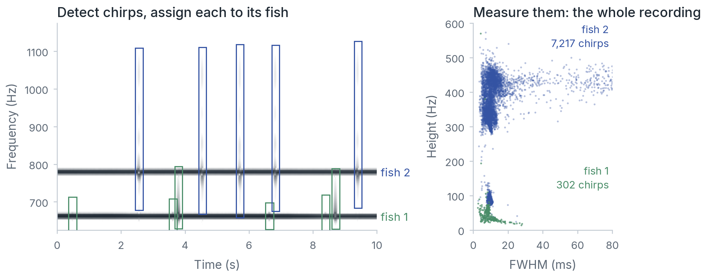

# chirpdetector

Find the chirps of wave-type weakly electric fish in electrode-grid
recordings, assign each chirp to the fish that emitted it, and measure its
height, width and undershoot.

<picture>
  <source media="(prefers-color-scheme: dark)" srcset="assets/overview-dark.png">
  
</picture>

<sub>Two <i>Apteronotus leptorhynchus</i> in a staged competition, recorded
with 15 electrodes. Left: ten seconds of the recording (the detector's
205-ms spectrogram, power summed over the electrodes); each box is a
detected chirp in the colour of the fish it was assigned to. Right: height
and full width at half maximum, from the decoder, of all 7,519 chirps of the
6-hour recording (621 wider than 80 ms are off the axis).</sub>

## Install

```sh
pip install "git+https://github.com/weygoldt/chirpdetector"
```

Python 3.13 or later; a CUDA GPU is optional. The released detector and
chirp-parameter decoder (81 MB) download on first use and are cached.
[Installation](docs/installation.md) covers uv, the extras and pinning a
release.

## Run

```sh
chirpdetector run --out detections /path/to/recording
```

A recording directory holds the raw grid data (fishgrid's
`traces-grid1.raw` with its `fishgrid.cfg`, or one multichannel wav file)
and the wavetracker frequency tracks of its fish. The result is
`detections/default/<recording>/chirps_rtdetr.parquet`: one row per chirp
with its time, frequency box and score, the emitter's track and the
assignment confidence, and its height, FWHM, width at 10 % and undershoot.
A QC report and annotated windows come with it. `--dataset DIR` runs every
recording in a directory; run the same command again and finished
recordings are skipped. The [quickstart](docs/quickstart.md) walks through
one recording.

From Python:

```python
from gridtools.io import load_tracks, open_recording
from chirpdetector.inference.spans import predict_span

recording, tracks = open_recording(path), load_tracks(path)
chirps = predict_span("default", recording, 0.0, 60.0, name="rec",
                      tracks=tracks, params="default")
```

## How well it works

| test | precision | recall | emitter correct |
|---|---|---|---|
| hand-labelled real recordings (365 chirps) | 0.938 | 0.992 | no ground truth |
| simulated test scenes (unseen fish and backgrounds) | 0.976 | 0.957 | 0.914 |

In a blind test on 1,010 simulated items, the detector found 96.3 % of the
chirps and an expert labeller 92.4 %; with the right emitter, 86.8 % and
81.2 %. The previous detector (v1) reached a recall of 0.701 on the same
real labels. [Limitations](docs/limitations.md) says what these numbers do
and do not show.

## Documentation

Start at [docs/README.md](docs/README.md).

- **Use:** [installation](docs/installation.md) ·
  [quickstart](docs/quickstart.md) · [pipeline](docs/pipeline.md) ·
  [Python API](docs/api.md) · [pretrained models](docs/models.md) ·
  [command line](docs/cli.md)
- **What it computes:** [post-processing](docs/postprocessing.md) ·
  [chirp parameters](docs/decoder.md) · [click removal](docs/clicks.md) ·
  [design notes](docs/design.md) · [limitations](docs/limitations.md)
- **Train and evaluate:** [datasets](docs/datasets.md) ·
  [detector](docs/training.md) · [decoder](docs/decoder-training.md) ·
  [evaluation](docs/evaluation.md) · [labelling](docs/labelling.md) ·
  [human against model](docs/benchmark.md) ·
  [development](docs/development.md)

## Versions and license

This is version 2 (tag `v2.0.0`). The detector of the chirp competition
paper (2024) is tag `paper-chirp-competition-v1`; v2 shares no models or
data formats with it.

MIT. `chirpdetector.preprocessing.clicks` is ported from audian and
wavetracker (GPL); see its module docstring.
